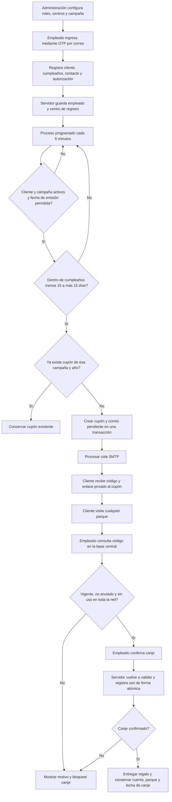
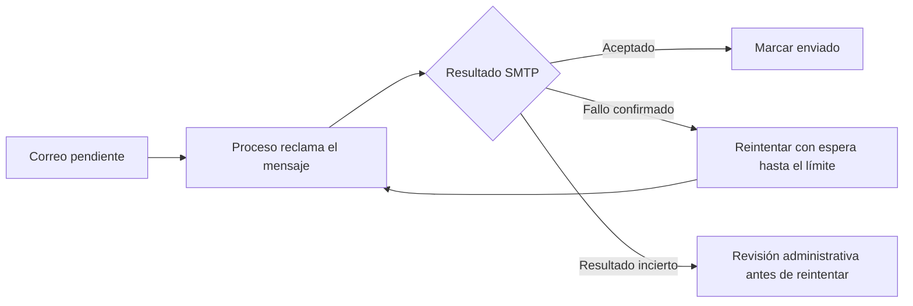

# Flujo del programa de cumpleaños

El personal registra clientes; el sistema prepara y envía el regalo automáticamente. El cliente presenta su cupón en cualquier parque de la red y un empleado confirma su único canje en la base central.

## Quién hace cada paso

| Responsable | Acción | Registro que queda |
| --- | --- | --- |
| Administración | Configura tipo, cantidad, descripción y condiciones del regalo; prepara y activa la campaña | Campaña y cambios auditados |
| Administración | Asigna usuarios, roles, centro operativo y alcance de consulta | Permisos y centros por cuenta |
| Empleado | Accede mediante OTP y registra los datos del cliente y su autorización | Cliente, cuenta, centro y fecha del alta |
| Proceso automático | Revisa la ventana de cumpleaños y crea el regalo una vez por campaña/año | Cupón con beneficio y vigencia propios, más cola de correo |
| Servicio de correo | Procesa la cola SMTP | Estado, intentos y resultado del envío |
| Cliente | Abre su correo y presenta el código o QR | El cliente no necesita cuenta ni OTP |
| Empleado del parque de visita | Consulta y confirma el canje | Cuenta, centro y fecha/hora reales del canje |
| Administración o supervisión autorizada | Revisa cupones, envíos, canjes y bitácora según permisos | Trazabilidad central |

El parque de registro lo toma el servidor de la cuenta del empleado. El parque de canje se determina cuando otro empleado confirma la entrega con su propia cuenta. No se eligen en el formulario, ni se reserva el regalo para un parque. Para identificar personas además del parque, usar cuentas individuales asignadas al mismo centro.

## Fechas y altas recientes

La ventana incluye **15 días antes y 15 días después**, incluyendo el día del cumpleaños: 31 fechas calendario. Por ejemplo, para un cumpleaños el **20 de octubre**, el cupón corresponde al **5 de octubre hasta el 4 de noviembre**, ambos incluidos, según la zona horaria de la aplicación.

| Momento del alta | Qué hace el sistema |
| --- | --- |
| Antes de la ventana | Guarda la inscripción y espera a la ventana de cumpleaños |
| Dentro de la ventana | Puede emitir en la siguiente ejecución del proceso si la campaña permite emitir |
| El último día de la ventana | Puede emitir ese día; conserva la fecha final original, sin extender 15 días desde el alta |
| Después de la ventana | Espera la siguiente ventana anual; no crea un cupón vencido |

El registro nunca envía el cupón directamente al guardar. Para que se emita deben coincidir cliente activo, campaña activa, fechas de emisión permitidas y proceso habilitado. Si el equipo o el planificador están detenidos no se ejecuta el envío. El 29 de febrero se considera 28 de febrero en años no bisiestos. Las ventanas pueden cruzar de mes o de año.

## Envío y revisión de errores

La cola procesa hasta 50 mensajes por ejecución y hasta cinco intentos ante fallos confirmados. SMTP aceptado no confirma lectura ni llegada a bandeja principal. Los resultados inciertos requieren revisión para evitar repetir un correo. Reintentar el envío conserva el mismo cupón. El OTP del personal se envía al solicitar acceso y no depende del proceso de campañas.

## Canje y cambios posteriores

- La consulta muestra vigencia y estado global. La confirmación vuelve a validar dentro de la transacción: si dos parques intentan canjear a la vez, solo uno puede confirmar.
- Sin conexión a la base central no se autoriza entregar el regalo. El empleado entrega después de recibir confirmación exitosa.
- Un cupón usado muestra el parque y la fecha de uso según los permisos disponibles; queda bloqueado en toda la red.
- Editar el beneficio de una campaña afecta nuevas emisiones. Los cupones existentes conservan lo que se les ofreció.
- Pausar una campaña detiene nuevas emisiones; los cupones anteriores y su cola de correo siguen su curso. Para retirar un cupón existe anulación con motivo.
- Varias campañas activas pueden generar varios regalos, uno por cliente, campaña y año. No activar campañas duplicadas por accidente.

La operación y los manuales por perfil están dentro de la aplicación. Para instalación, SMTP y planificador consulta [INSTALACION.md](../INSTALACION.md). Para desarrollo y revisiones consulta [CONTRIBUTING.md](../CONTRIBUTING.md).
