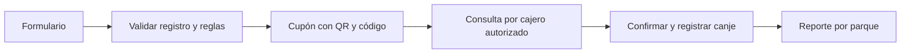

# Propuesta: Carrousel Cumple

> **Propuesta histórica:** el usuario sustituyó este flujo por registro independiente y regalo automático anual por correo, vigencia -15/+15 y diseño/manual/tutoriales basados en Helpdesk Carrousel. Consultar [la especificación revisada](superpowers/specs/2026-09-18-regalo-automatico-helpdesk-design.md). Los apartados siguientes sobre solicitud o emisión inmediata de cupón ya no describen el alcance vigente.

Fecha: 16 de septiembre de 2026.

Estado: diseño general de producto. Desde el 17 de septiembre existe una primera demo local descrita en el README y en `docs/superpowers/plans/2026-09-16-cumple-local.md`. Las integraciones productivas de este documento siguen siendo propuestas.

Actualización de alcance: el usuario confirmó que todo es nuevo y no existe un beneficio comercial definido. La demo permite configurarlo y probarlo con datos ficticios; esto no activa ninguna oferta real.

## 1. Objetivo y contexto confirmado

Convertir el registro de cumpleaños en un cupón identificable, con vigencia y un canje trazable por parque. El objetivo inicial es saber quién se registró, qué beneficio se emitió y dónde/cuándo se utilizó.

La carpeta de este nuevo proyecto estaba vacía. El Portal Carrousel existente está en `C:/xampp/htdocs/portal` y su README lo describe como un catálogo central de accesos internos. La inspección de `index.php` no encontró un módulo activo de cumpleañeros. No se observó una sesión de usuario ni una conexión de base de datos que puedan reutilizarse como autenticación del nuevo sistema.

El sitio [oficial de Carrousel](https://carrousel.com.gt/) describe entretenimiento familiar y juegos electrónicos/de habilidad en Guatemala. Esto favorece un flujo de canje presencial. No se toma su número público de ubicaciones como catálogo operativo: los parques participantes se definirán con Carrousel.

Las aplicaciones vecinas documentan PHP/PDO y MariaDB. Es una base compatible a evaluar; antes de implementar se comprobarán las versiones reales del entorno que alojará el proyecto.

## 2. Alternativas y recomendación

| Alternativa | Ventaja | Compromiso |
| --- | --- | --- |
| **Aplicación propia enlazada al portal — recomendada** | Registro, reglas, canje y reportes adecuados a parques y personal de Carrousel. Control del código y datos. | Requiere desarrollo, alojamiento, respaldo y mantenimiento. |
| Servicio de cupones más formulario externo | Permite poner a prueba el proceso con menos desarrollo inicial. | Suscripción y conexiones adicionales para cumpleaños, contactos, sucursales y reportes. |
| Formulario y hoja de cálculo | Útil para explorar las preguntas del registro. | Para un canje simultáneo y controlado exige desarrollar validación, permisos y trazabilidad adicionales. |

La recomendación toma como referencia el canje presencial de [Coupon Carrier](https://www.couponcarrier.io/) y las reglas de cumpleaños de [Voucherify](https://www.voucherify.io/promotion-examples/birthday-campaign). Es una valoración de encaje, no una clasificación universal del mercado ni una decisión de compra.

## 3. Público confirmado y reglas por definir

El usuario confirmó que esta etapa está dirigida **exclusivamente a clientes de Carrousel**. El beneficiario es el cliente cumpleañero. Para menores se propone el registro mediante un adulto responsable, que podrá asociarse a varios beneficiarios. El personal de Carrousel participa como operador, supervisor o administrador del sistema.

Para cerrar el alcance se necesitan cinco decisiones de negocio:

1. **Beneficio exacto:** por ejemplo, fichas/créditos de juego, descuento en recarga o un regalo. Los ejemplos no establecen cantidades ni una oferta real.
2. **Vigencia:** día, semana, mes del cumpleaños u otra ventana, y si existe anticipación mínima para registrarse.
3. **Operación del registro:** cliente desde un enlace público, personal desde el parque o ambos.
4. **Parques y condiciones:** en cuáles se canjea y si requiere recarga/compra, edad elegible u otra condición.
5. **Frecuencia del beneficio:** se propone una emisión por beneficiario, campaña y año del cumpleaños; Carrousel debe confirmar si esa es la política comercial deseada.

Estas reglas estarán centralizadas en una campaña. Una campaña incompleta se conserva como borrador y no emite cupones. Cambiar una campaña no debe alterar silenciosamente lo prometido en cupones ya emitidos: cada cupón conserva la versión de sus condiciones.

## 4. Recorrido propuesto

**Registro.** Formulario breve, pensado primero para celular. Nombre del cumpleañero, fecha de cumpleaños, contacto, parque de preferencia y aceptación de condiciones. Para menores, contacto y nombre del adulto responsable. El año de nacimiento se solicita únicamente si la edad forma parte de la promoción. La autorización opcional para recibir publicidad se separa de los términos de la promoción.

**Cupón.** Pantalla de celebración con marca Carrousel, nombre, beneficio, vigencia, parques participantes, condiciones y código único. Puede mostrarse desde el celular o imprimirse. El QR y el código manual representan el mismo cupón; no son dos beneficios distintos.

**Validación.** Personal con sesión iniciada escanea el QR o escribe el código. El servidor muestra si está vigente, usado, vencido, anulado o todavía fuera de su ventana de uso. Consultar o escanear no consume el cupón.

**Canje.** El cajero comprueba las condiciones y confirma la entrega. El servidor registra el canje una sola vez junto con el parque y el operador. El canje del cupón es un registro de entrega; no acredita automáticamente saldo en una tarjeta de juegos ni aplica un descuento en el POS. Esa integración sería un alcance adicional.

**Seguimiento.** Administración consulta registros, cumpleaños por período, cupones emitidos, canjeados, vencidos y anulados. Puede filtrar por campaña, parque y fechas y exportar CSV.

## 5. Pantallas de la primera versión

| Pantalla | Contenido y acción principal |
| --- | --- |
| Registro | Beneficio y condiciones visibles, campos breves, validación clara. |
| Mi cupón | Beneficiario, beneficio, QR, código, vigencia y opción de imprimir. |
| Canjear | Escáner o búsqueda por código, estado, condiciones, confirmación. |
| Panel | Indicadores de la campaña y resultados por parque. |
| Registros y cupones | Búsqueda, detalle, estado, historial y exportación autorizada. |
| Configuración | Campaña, parques, personal, roles y condiciones. |

El diseño usará el logo y la identidad del portal. La pantalla del cliente tendrá un tono de celebración; las pantallas operativas priorizarán lectura rápida, mensajes claros y botones de acción visibles. El estado siempre aparecerá en texto, además del color.

## 6. Integración con el portal

- Proyecto y base de datos independientes; el portal conserva su función de punto de entrada.
- Añadir un acceso «Cumpleañeros» en la categoría operativa del catálogo cuando el sistema esté probado.
- Ruta candidata de administración: `/cumpleaneros/`, con el servidor apuntando exclusivamente a la carpeta pública del proyecto. La ruta final dependerá del alojamiento.
- Autenticación propia para operadores. No se presupone que abrir un enlace desde el portal concede acceso ni que exista inicio de sesión único.
- Si el cliente se registra desde su teléfono fuera de la red interna, necesita una URL accesible por HTTPS. Una dirección interna del portal no resuelve ese acceso.
- La cámara para leer QR requiere un contexto admitido por el navegador, normalmente HTTPS o localhost. Se conserva el código manual como alternativa.

Esta fase de investigación no cambia accesos, archivos productivos, cuentas ni bases de datos existentes.

## 7. Roles propuestos

| Rol | Alcance |
| --- | --- |
| Administrador | Configura campañas, parques, operadores y permisos; consulta toda la operación. |
| Supervisor | Consulta su grupo de parques, revisa incidencias y solicita o realiza anulaciones según el permiso asignado. |
| Operador de parque | Registra si se habilita el modo asistido, consulta y canjea en su parque asignado. |
| Cliente | Registra su participación y consulta su cupón; no accede a listados internos ni confirma canjes. |

Los permisos y el alcance por parque se aplican en el servidor. Ocultar una opción del menú no sustituye la autorización.

## 8. Reglas de emisión y canje

- Regla propuesta, pendiente de confirmación comercial: un cupón por beneficiario registrado, campaña y año del cumpleaños. El año corresponde al cumpleaños celebrado, incluso si el período de uso cruza diciembre/enero.
- Un adulto puede registrar a varios hijos: teléfono y correo no se usan como identificador único del cumpleañero.
- Los posibles duplicados se detectan por combinación de contacto, nombre normalizado y fecha, y se revisan sin confundir automáticamente a personas diferentes. Esto no constituye una prueba de identidad.
- Reintentar la misma solicitud no crea otro cupón. La restricción anual se protege también en la base de datos.
- Código y token impredecibles; el QR no incluye teléfono, fecha de nacimiento ni otros datos personales.
- Un QR de uso único impide un segundo canje, pero puede transferirse antes de utilizarlo. La comprobación del beneficiario y condiciones forma parte del trabajo del cajero según la política que defina Carrousel.
- La confirmación del canje valida en una sola operación de base de datos: estado, vigencia, parque permitido, permiso del operador y ausencia de otro canje. Dos cajas simultáneas no deben entregar dos beneficios.
- Las fechas se evalúan en `America/Guatemala`. Se prueban los cambios de año y los cumpleaños del 29 de febrero; la campaña debe tener una política explícita para años no bisiestos.
- Si no hay conexión con el servidor, no se marca el cupón como canjeado desde una copia local. La operación exige confirmación del servidor.
- Anular requiere permiso y motivo. Un cupón canjeado conserva su historial; no se permite simplemente borrar su canje para reutilizarlo.

Estados: emitido (con vigencia aún futura o actual), canjeado y anulado. Vencido se determina cuando ya pasó la fecha límite y no fue canjeado ni anulado. Los reportes distinguen esos estados sin sumarlos dos veces.

## 9. Datos mínimos propuestos

| Entidad | Propósito |
| --- | --- |
| Campaña y versión | Beneficio, vigencia, condiciones, elegibilidad y parques. |
| Contacto responsable | Canal de contacto y consentimientos necesarios. |
| Beneficiario | Cumpleañero y fecha requerida para la campaña. |
| Parque | Catálogo operativo confirmado por Carrousel. |
| Operador y permisos | Acceso y parques asignados. |
| Cupón | Beneficiario, año de cumpleaños, versión de campaña, token, vigencia y estado. |
| Canje | Cupón, parque, operador y fecha; como máximo un canje por cupón. |
| Auditoría | Emisión, correcciones, anulaciones y operaciones administrativas relevantes. |

No se propone almacenar fotografías de documentos de identidad para la primera versión. Los datos de prueba se mantienen ficticios. Credenciales y respaldos se guardan fuera del repositorio y de la carpeta pública.

## 10. Indicadores útiles

- Registros del período y próximos cumpleaños.
- Cupones emitidos, pendientes, canjeados, vencidos y anulados.
- Canjes por parque y período.
- Tasa de canje de una cohorte: cupones canjeados de los emitidos en esa cohorte / cupones emitidos de la misma cohorte. Mostrar sus anulaciones por separado.
- Intentos de canje rechazados por estado, vencimiento o parque no permitido.

Sin datos de compras o integración al POS no se afirmarán ventas generadas, retorno de inversión ni aumento de ingresos. Los canjes demuestran uso del beneficio, no por sí solos ventas incrementales.

## 11. Alcance por etapas

**Primera versión operativa:** registro, campaña configurable, cupón imprimible con QR/código, acceso de personal, canje único en servidor, historial, filtros y exportación CSV. Registro público o asistido según la decisión de negocio.

**Siguiente etapa:** emisión anual programada y recordatorios por correo o WhatsApp, una vez definidos proveedor, remitente, consentimiento y costos. Guardar un teléfono no equivale a tener envío por WhatsApp. Abrir un enlace para compartir tampoco equivale a envío automático.

**Evolución posterior:** integración con POS/tarjetas de juego, wallet digital, segmentación o programa de lealtad, si los resultados y la operación lo justifican.

## 12. Verificación antes del piloto

1. Registro válido genera el cupón correcto; se rechazan fechas de nacimiento imposibles o futuras cuando se capture el año. Los cumpleaños próximos se aceptan según la ventana autorizada y las condiciones incumplidas reciben mensajes claros.
2. Reintentos de registro no duplican cupones; varios hijos con el mismo contacto siguen permitidos.
3. QR y código manual encuentran el mismo cupón; verlo no lo consume.
4. Dos confirmaciones concurrentes producen exactamente un canje exitoso.
5. Cupones vencidos, anulados o usados y parques no elegibles son rechazados por el servidor.
6. Operador sin permiso no accede a reportes globales, exportaciones ni configuración.
7. Fechas límite, cambio de año y 29 de febrero respetan las reglas acordadas.
8. Flujo completo probado en computadora y celular, incluida impresión y lectura de QR real.
9. Totales y filtros de reportes coinciden con un conjunto pequeño de datos de prueba conocido.
10. Piloto con campaña de prueba y parques elegidos por Carrousel antes de anunciar un beneficio real.

## 13. Próxima decisión

Definir qué recibirá el cliente cumpleañero: fichas/créditos de juego, descuento en recarga, regalo u otro beneficio. Después se concretarán la vigencia y las condiciones de uso para cerrar el formulario, el cupón y el plan de implementación.
